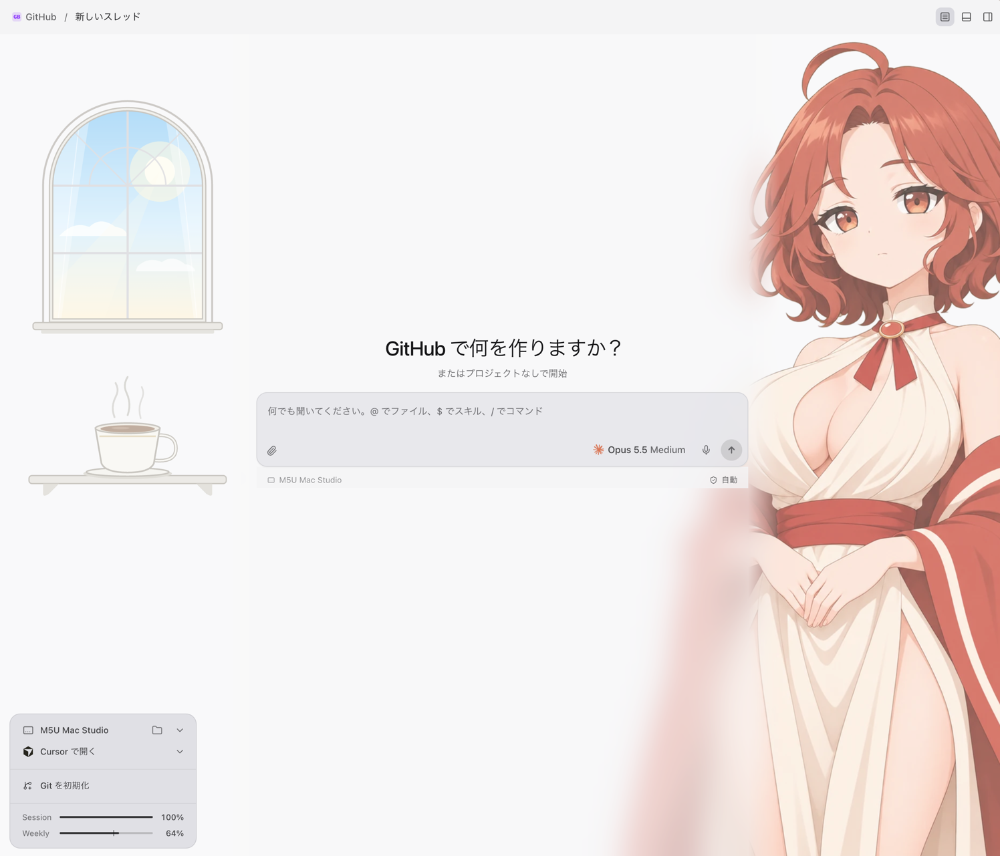

# Heroines — T3 Code theme

[T3 Code](https://github.com/pingdotgg/t3code) 用のライトテーマ。いま使っているプロバイダー・モデルの種類と作業状態に合わせて、会話欄の右に立ち絵が出ます。



## 特徴

- **立ち絵が切り替わる**: モデル選択ボタンの表示（Claude / GPT / Gemini とモデル名）から、10 キャラ × 3 表情（待機・作業中・承認や質問待ち）の中から選びます。該当しないモデルには汎用キャラが出ます。
- **左側の「窓と本」**: 5 時間制限の残量で窓の外の空が朝から夜へ変わり、コンテキスト使用率に応じて本が積み上がります（SVG と CSS のみ）。
- **スレッド詳細カードを左下へ移動**: 立ち絵の顔と重ならないようにしています。
- 色は無彩色のグレー（地 `#f4f4f5`、差し色 `#52525b`）で、どのキャラが出ても浮きません。

## インストール

1. `heroines.json` と `heroines.webp` を、**同じフォルダに**置きます（ファイル名はそのまま）。
   ```bash
   mkdir -p ~/.t3/userdata/themes
   cp heroines.json heroines.webp ~/.t3/userdata/themes/
   ```
2. T3 Code の **Settings → Appearance** で `Heroines` を選びます。CLI なら `t3 theme set heroines` でも切り替えられます。

テーマが一覧に出ないときは、`t3 service restart` でサーバーを再起動してください。

## 必須設定: スレッド詳細を表示する

左側の「窓と本」は、スレッド詳細パネルに表示されている情報を読み取って動いています。次のどちらかが非表示だと、対応する表示が動きません。

- **5 時間制限（使用量）の行**: 窓の外の空（朝→夜）に使います。
- **コンテキスト使用率の行**: 積み上がる本の数に使います。

T3 Code の設定で、スレッド詳細にこの 2 つの行が出るようにしてください。スレッド詳細パネルを左下に移す機能も、このパネルが表示されていることが前提です。立ち絵の切り替えは、スレッド詳細とは関係なく動きます。

## 動作確認環境

- T3 Code v0.1.11（デスクトップアプリ）

CSS は `data-` 属性などの画面構造に頼っています。T3 Code のアップデートで見た目が崩れることがあります。

## 仕組み

- `heroines.json`: テーマ本体（色と CSS）。
- `heroines.webp`: 立ち絵のスプライトシート（10240×4608、1 コマ 1024×1536、10 列 × 3 行）。
  - 行: 待機 / 作業中 / 話しかけ
  - 列: 0〜2 Claude 系、3〜5 GPT 系、6〜8 Gemini 系、9 汎用

自分で立ち絵を差し替えたいときは、同じ配置のスプライトを作って `heroines.webp` を置き換えてください。

## 注意

- 非公式の個人制作です。Anthropic・OpenAI・Google・T3 Code の開発元とは関係ありません。
- キャラクターは画像生成 AI で作ったオリジナルのイラストで、各社のロゴは使っていません。

## ライセンス

[MIT](./LICENSE)
